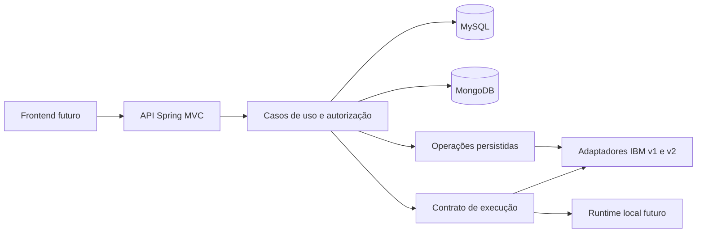

# Arquitetura e stack

## Stack observada

| Tecnologia | Configuração local | Uso |
|---|---|---|
| Java | 21 | Linguagem |
| Spring Boot | 4.1.2 | Framework |
| Spring Web MVC | Starter declarado | HTTP |
| Spring Security | Starter declarado | Segurança |
| MongoDB | Starter declarado | Persistência documental prevista |
| MySQL Connector/J | Dependência runtime | Driver; acesso relacional ainda não configurado |
| Maven | Wrapper aponta para 3.10.0 | Build |
| Maven Wrapper | 3.3.4 | Inicialização do build |
| Spring Boot DevTools | Runtime opcional | Desenvolvimento |
| JUnit Jupiter e starters de teste | Teste básico presente | Validação |

Fontes: `../pom.xml`, `../.mvn/wrapper/maven-wrapper.properties` e `../src`.

## Componentes propostos

Spring Data JPA, Flyway com suporte a MySQL e Bean Validation foram adicionados na implementação de identidade. H2 foi adicionado apenas para testes. Documentação OpenAPI e observabilidade continuam propostas. Consulte [Login e contas](10-login-e-contas.md) para o estado implementado.

## Organização

Adotar monólito modular, uma aplicação implantável, com pacotes por domínio sob `com.tabula.tabula_backend`:

```text
identity/       usuários, autenticação e autorização
portfolio/      portfólios, membros e projetos
integration/    conexões, destinos e adaptadores IBM
flow/           documentos, rascunhos e versões
conversation/   ciclo de vida dos atendimentos e coordenação dos turnos
runtime/        processamento, contexto e contrato das engines
history/        consultas de conversas, transcrições e traces
diagram/        projeções de nós e conexões
operation/      trabalhos assíncronos, outbox e reconciliação
audit/          trilha de ações
shared/         erros e tipos técnicos realmente compartilhados
```

Usar Spring MVC com respostas JSON e camadas dentro de cada módulo: `controller`, `service`, `repository`, `model` e `dto`, acrescentando `client` e `config` quando necessários. Criar apenas os pacotes que tiverem implementação. Controllers não acessam bancos ou clientes IBM diretamente. Um módulo acessa outro por contratos de serviço; repositories e entidades internas não se tornam API pública entre módulos.

Os limites e dependências estão detalhados em [Módulos e responsabilidades](09-modulos-e-responsabilidades.md). O pacote `runtime` passa a ser o nome adotado para o contrato de execução anteriormente descrito como `execution`.



## Decisões iniciais

| Decisão proposta | Motivo | Consequência |
|---|---|---|
| Monólito modular | Menor custo inicial de operação | Exige disciplina de dependências entre módulos |
| MySQL como autoridade de metadados | Relações, autorização e transações locais | JSON fica referenciado por ID |
| MongoDB para conteúdo e execução detalhada | Fluxos são documentos JSON | Exige consistência eventual entre bancos |
| Modelo visual separado do formato IBM | Preservar semântica e campos desconhecidos | Conversores precisam de validação |
| Adaptadores por capacidade | Evitar equivalência artificial entre APIs | Operações podem ser indisponíveis por destino |
| Destino e API copiados na abertura do atendimento | Evitar redirecionar sessões por alteração de cadastro | Não fixa uma release IBM nem executa o snapshot local |

Nenhuma transação relacional deve permanecer aberta enquanto aguarda uma chamada IBM. Não adotar microserviços, broker ou cache distribuído sem uma necessidade demonstrada.
